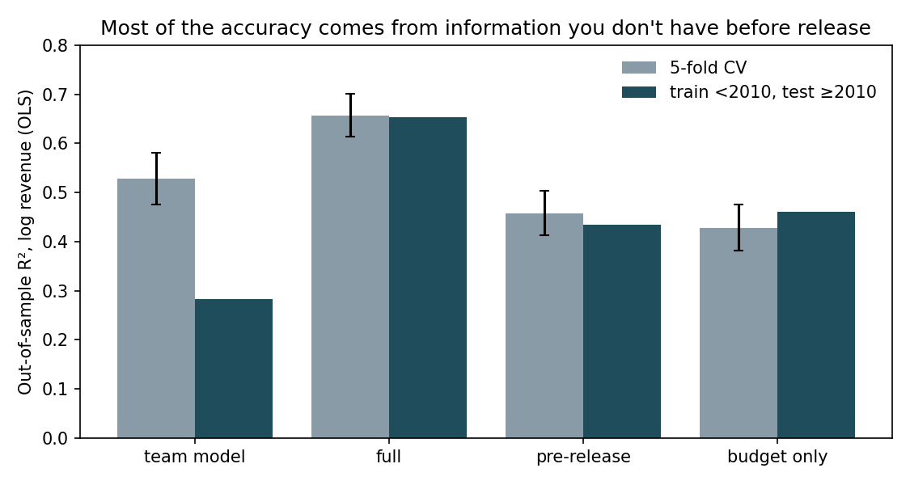

# Can You Forecast Box Office Before Release?

A course project found that a movie's budget, audience votes, popularity, rating, runtime, and GDP explain **54% of the variance in log box-office revenue**. That number sounds like a forecast. It isn't one: vote count, rating, and popularity are all measured *after* a film opens.

This repo asks how much of that accuracy survives when a model can only use information a studio has before release, and evaluates it on films the model has never seen.

**Short answer: not much.** Holding out films released in 2010 or later, a pre-release model explains **43%** of the variance. **Budget alone explains 46%**.



## Results

3,222 feature-length films from the TMDB 5000 dataset. Target: log revenue.

| Model | Features | In-sample adj. R² | 5-fold CV R² | Train <2010 → test ≥2010 |
|---|---:|---:|---:|---:|
| Team model (replication) | 6 | **0.537** | 0.528 | **0.283** |
| Full (pre- + post-release) | 28 | 0.665 | 0.657 | 0.653 |
| Pre-release only | 25 | 0.469 | 0.458 | 0.434 |
| **Budget only** | 1 | 0.434 | 0.428 | **0.460** |
| Full, gradient boosting | 28 | — | 0.611 | 0.598 |
| Pre-release, gradient boosting | 25 | — | 0.388 | 0.372 |

All rows are OLS except the two gradient-boosting rows. Full per-model output is in [`results/metrics.md`](results/metrics.md).

### Findings

1. **About a third of the full model's out-of-sample R² comes from post-release information.** Removing vote count, rating, and popularity drops 5-fold CV R² from 0.66 to 0.46.

2. **Beyond budget, pre-release features add almost nothing.** Genre, release season, runtime, language, and lagged GDP raise CV R² by 0.03 over budget alone. On future films they *lower* it (0.434 vs 0.460), because the extra features fit patterns in older films that don't carry forward.

3. **The team model collapses on future films (0.53 → 0.28), and `popularity` is the cause.** TMDB popularity is a single snapshot from when the dataset was collected (2017), so recent films look more popular (median 30 vs 18 for pre-2010 films). Dropping that one variable restores post-2010 R² to 0.53. Dropping GDP instead makes it worse. A random split can't catch this kind of drift; a time split does.

4. **Gradient boosting underperforms OLS here.** With about 3,000 films and a log–log budget relationship that is already close to linear, a flexible model fits noise rather than structure.

The original model replicates exactly: in-sample adjusted R² of **0.537**, matching the course report.

## Method

**Data.** [TMDB 5000 Movie Dataset](https://www.kaggle.com/datasets/tmdb/tmdb-movie-metadata) (movies file), plus annual U.S. GDP (BEA, 1929–2023).

**Cleaning.**
- Budget and revenue of 0 are treated as missing.
- Only `Released` films are kept.
- Films under 60 minutes are dropped (shorts and data errors).
- Revenue and budget are `log1p`-transformed.

**Feature sets.**
- **Replication:** the course model, with same-year nominal GDP and raw vote count and popularity.
- **Pre-release:**
  - log budget and runtime
  - release year
  - **prior-year** real GDP (a studio can't know the current year's GDP when greenlighting a film)
  - English-language flag
  - multi-hot genres (30+ films each)
  - summer and holiday release flags
- **Full:** pre-release plus log vote count, vote average, and log popularity.
- **Budget only:** the baseline everything else has to beat.

A unit test fails if any post-release column enters the pre-release matrix.

**Evaluation.**
- **5-fold CV R²** (seed 108).
- **Time split:** train on films released before 2010, test on the 945 released from 2010 on. This is the closer match to actual forecasting.
- In-sample adjusted R² is reported only for comparison with the original project.

## Limitations

- **Data entry errors survive the cleaning.** About 15 films list revenue under $1,000 (*Rugrats in Paris*: $103), almost certainly millions entered as dollars. They're kept so the replication stays exact. They drag down every model roughly equally, so the comparisons still hold, but the absolute R² values are understated.
- **Selection bias.** Films with a known budget and revenue skew toward English-language studio releases. Results may not generalize to independent or international films.
- **R² on log revenue isn't dollar accuracy.** A good log fit can still miss individual films by hundreds of millions of dollars.
- **Correlation, not cause.** Budget stands in for marketing spend, release width, and franchise status, none of which this dataset records.

## Reproduce

```bash
python -m venv .venv && source .venv/bin/activate
pip install -e ".[dev]"
# Download tmdb_5000_movies.csv from Kaggle into data/raw/ (not redistributed here)
# Place U.S. GDP data at data/raw/us-gdp.csv (columns: date, level-current, level-chained)
boxoffice          # writes results/
pytest -q          # runs on synthetic data; no download needed
```

## Layout

```
src/boxoffice/
  data.py        cleaning, genre parsing, GDP merge (with one-year lag)
  features.py    feature-set definitions and the pre/post-release boundary
  evaluate.py    CV, time-split, and in-sample metrics
  run.py         CLI: runs every model, writes tables and figures
tests/           pipeline tests on synthetic data
results/         metrics and figures from the last run
```

## Origin

This is an independent follow-up to a UCSD COGS 108 (Spring 2026) group project that ranked predictors of box-office revenue. The code here is new. The original team analysis is not included.
